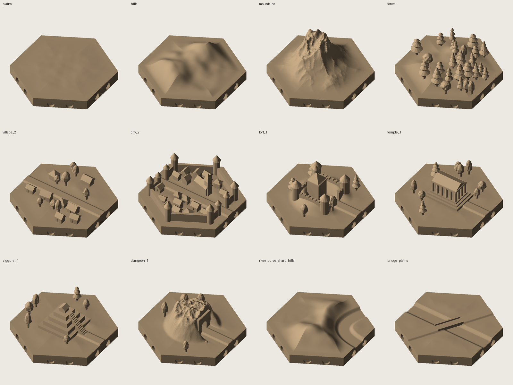
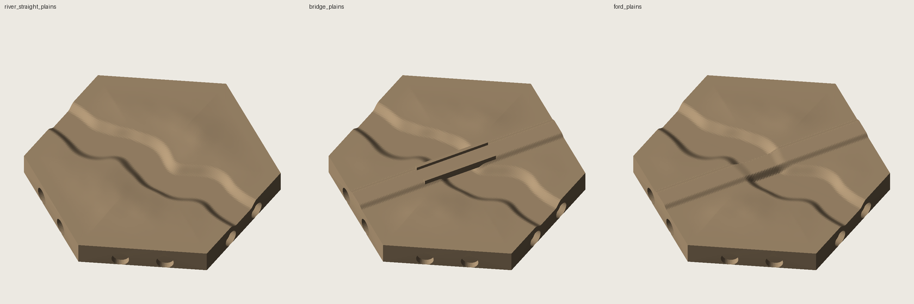
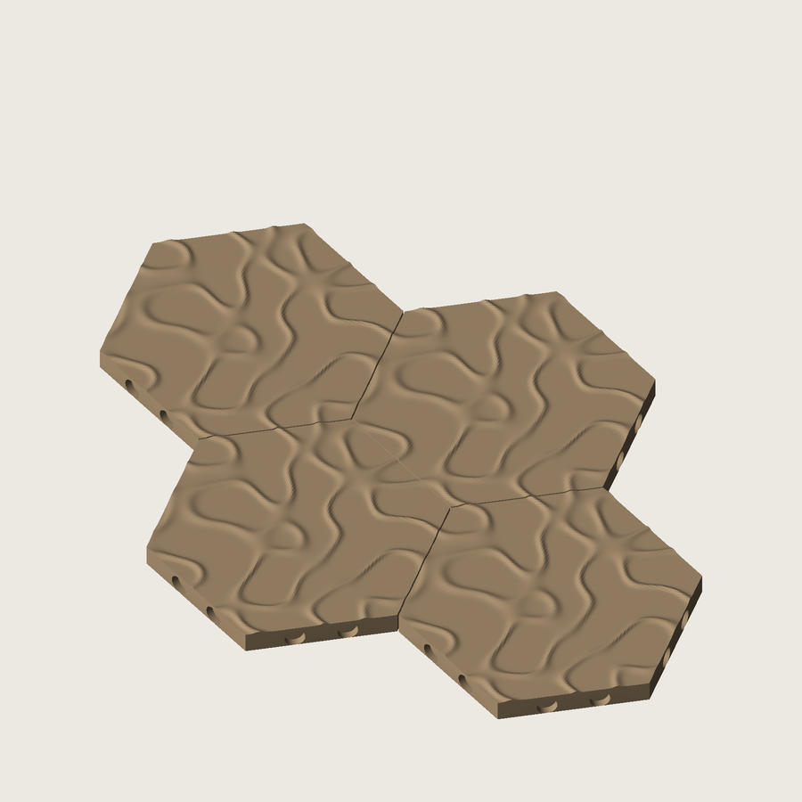
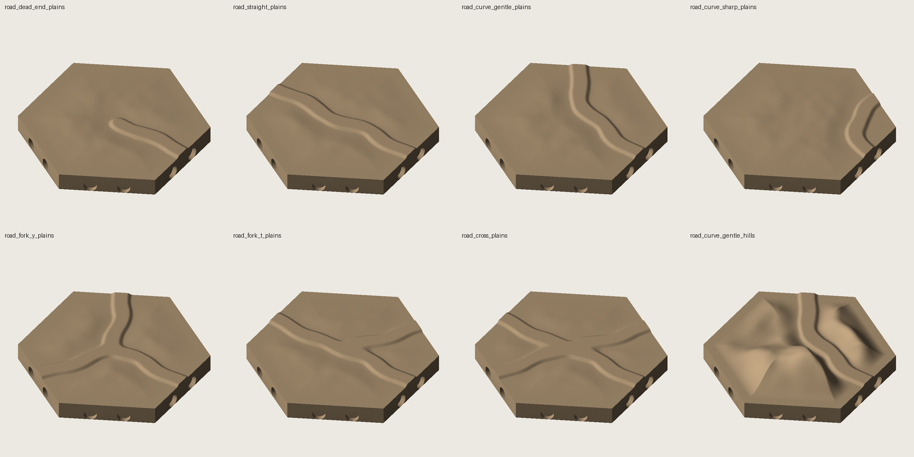
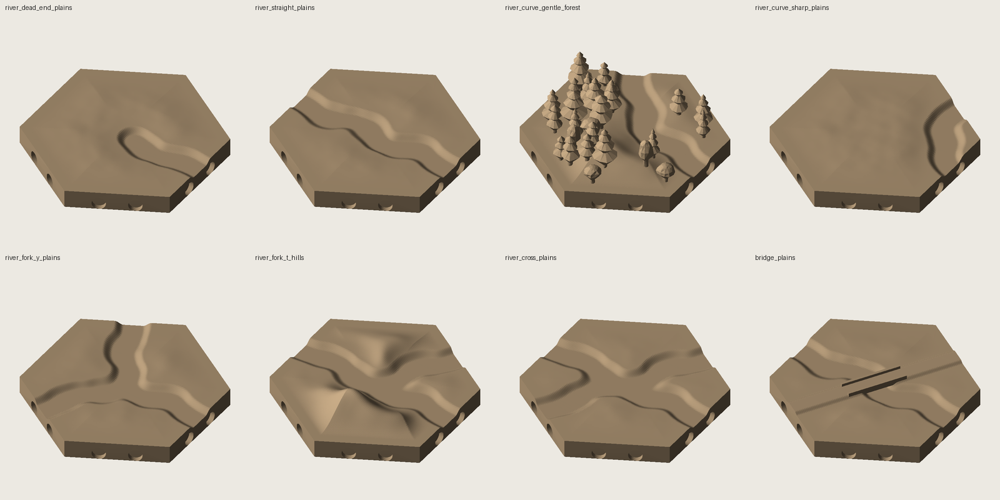
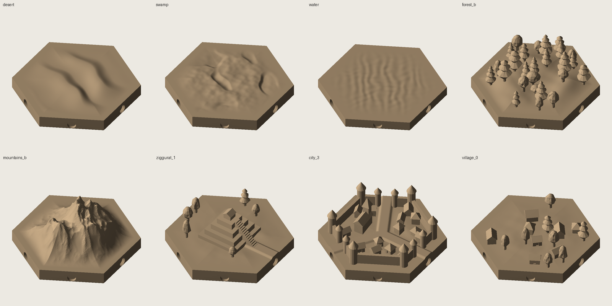
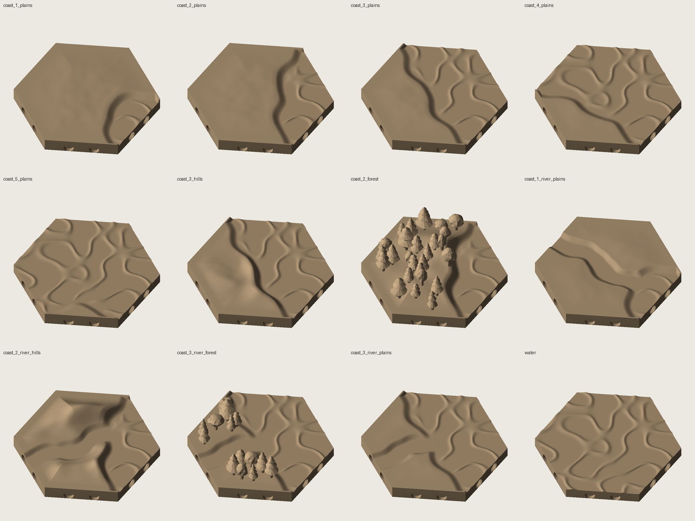
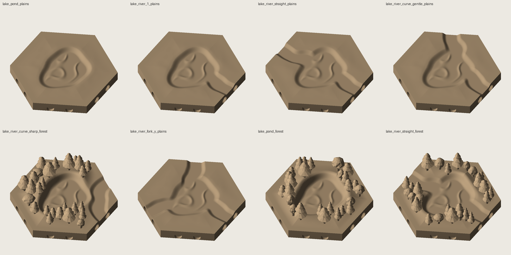

# hex-terrain

A Python generator for **3D-printable, interlocking hex map tiles** for tabletop games.
Instead of the flat symbols of classic hex maps, each tile is a small sculpted piece of
"real world" terrain: craggy mountains, rolling hills, clumps of individual trees,
villages, walled cities, forts, temples and dungeon entrances. Rivers and roads run across
tiles at every angle, so you can lay out a map on the table and rebuild it any way you like.



The repository holds the generator, not the STL files. Run it once and you get 109 ready-to-slice
STLs in about 30 seconds.

## Quick start

```
pip install numpy scipy trimesh manifold3d pillow
python3 generate.py --set all          # writes 109 STLs to ./stl
python3 validate.py stl                # printability report
python3 preview.py sheet.png stl/*.stl --cols 4
```

Requires Python 3.9+. No GPU or CAD program is needed; previews are software-rendered.

## What it makes

| Group | Tiles |
|---|---|
| Terrain | plains, hills, mountains, forest, desert, swamp, water (hills, mountains and forest also have a second variant, `_b`) |
| Roads | dead end, straight, gentle curve, sharp curve, Y-fork, T-fork, crossroads, on plains, hills, forest and desert |
| Rivers | the same seven patterns, on plains, hills and forest |
| Crossings | bridge, ford |
| Coasts | water on 1 to 5 edges (cove, corner, straight shore, bay, cape), on plains, hills and forest; plus river mouths that run into the sea |
| Lakes | a pond in the middle of a tile, with 0 to 3 rivers running through it, on plains and forest |
| Villages | no road, road ends, road passes through |
| Walled cities | one, two (opposite) or three gates |
| Other features | fort, classical temple, ziggurat, dungeon entrance cut into a hill (each with and without a road where it makes sense) |

Name pattern: `road_curve_gentle_forest`, `river_fork_y_hills`, `village_2`, `city_3` and so on.
The number on features is how many road exits the tile has.

Roads and rivers are listed by the edges they use; print one and rotate it. Six rotations
cover everything, fewer for symmetric tiles. `fork_t` is one-handed, so mirror it in your slicer
for the other hand.

**Meandering paths.** Rivers and roads wander, and rivers also swell and narrow. The meander fades
to nothing at every edge, so each path still leaves the tile at the edge midpoint, perpendicular,
with the standard width, and any tile still joins any other. The walled and fortified feature tiles keep
straight paths so gates line up; villages meander gently. The bridge and ford tiles use exactly the same
river as `river_straight_plains` (same seed and terrain) with a straight road laid across it, and the bridge
deck is placed where the road meets the river.


`--organic 0` gives the old geometric paths, `--organic 1.5` wilder ones.

**Water.** The `water` tile sits 1 mm below the land, exactly the river floor level, so rivers
flow straight into lakes. Its surface carries a wavy crest pattern that runs right to the edge
(troughs at river level, crests up to 0.35 mm above). The pattern is the same on every water
tile and tiles the hex lattice, so it continues unbroken across shared edges.







## Coasts and lakes



**Coasts** are land tiles where open water reaches whole edges. `coast_N_<terrain>` has water on its first
`N` edges (edges 0 to N-1) and land on the rest: `coast_1` is a cove, `coast_2` a corner, `coast_3` a straight
shore, `coast_4` a broad bay and `coast_5` a cape with a single land edge. Water edges carry exactly the same
ripple pattern as the `water` tile, so they join water tiles (or other coasts) with no visible seam; land edges
keep the normal flat rim. The shoreline wanders, with a short beach (the water sits 1 mm below the land).
`coast_N_river_<terrain>` (N = 1, 2, 3) adds a river that crosses the land and runs out into the sea.

**Lakes.** A lake is just water tiles ringed by coast tiles, so the coasts double as lake shores. For lakes
that fit inside one hex there are `lake_pond_*` tiles, a pond in the middle with land to every edge, and
`lake_river_*` tiles (1 exit, straight, gentle curve, sharp curve, Y-fork) where rivers flow into, through or
out of the pond. Their river edges are the standard river profile, so they join any river tile.



## Tile geometry

- Pointy-top hexagon, **40 mm flat-to-flat**, printed 0.2 mm smaller so tiles fit without sanding
- 5 mm base slab with a 0.4 mm bottom chamfer to avoid elephant's foot
- Tallest tile is 21 mm (mountains); most are 5-17 mm
- Every tile has a perfectly flat 2 mm rim, and terrain rises smoothly from it
- Rivers are 6 mm wide and 1 mm deep; roads are 4 mm wide and 0.5 mm raised. They cross each
  edge at the midpoint, perpendicular, with an identical profile, so
  **any tile joins any tile, in any rotation**
- Water sits at river-floor level, so rivers and lakes meet seamlessly
- Water ripples are lattice-periodic, so water tiles placed in the same orientation match exactly;
  turning one by 60 degrees leaves a seam step of at most 0.35 mm

## Magnets

Each edge has two 3 x 1 mm disc magnet pockets (12 per tile), open to the side and 8 mm apart.
Insert them so that, going anticlockwise around each edge, the first pocket faces **N** outward
and the second faces **S** outward. Every edge then attracts every other edge in any rotation.
A single magnet per edge would repel whenever a tile is turned by 60 degrees, which is why the
pockets come in pairs.

Other sizes: `--magnet-d 4 --magnet-t 2`. One per edge: `--magnets-per-edge 1`. None: `--no-magnets`.
Pockets sit below the lowest surface at every edge, so rivers never break into them.

## Printing

- Print flat base down. No supports are needed: tree skirts and tower roofs are within about
  40 degrees of vertical, and the bridge deck, temple roof, ziggurat-top shrine and dungeon arch are
  short bridges of a few millimetres
- 0.4 mm nozzle, 0.12-0.16 mm layers, 15-20 % infill
- Mountains and trees look best at 0.12 mm layers; the finest details (tower tops, columns) are 0.6-1 mm wide
- `validate.py` reports each tile's height, volume and overhang area

## How it works

1. **Heightmap.** Each tile starts as a heightfield on a 0.3 mm grid. Terrain comes from vectorised
   gradient noise: ridged noise under a few Gaussian peaks for mountains, smoothed low-frequency noise for
   hills, warped sawtooth ridges for dunes, tussocks and pools for swamp. A smooth mask forces the height
   to zero across the rim so neighbouring tiles always match. Water is the exception: its ripples come from
   waves on the hex reciprocal lattice, which repeat exactly from tile to tile.
2. **Roads and rivers.** Paths leave each edge midpoint radially and join through cubic Bezier curves
   (two exits) or spokes (three or more). A sinusoidal sideways wiggle and width variation are added,
   both tapered to zero near the edges so tiles still match. Terrain is flattened or valley-shaped
   around the path, roads are raised and rivers carved. Bridge and ford tiles keep rigid paths.
3. **Solid and clipping.** The heightfield is closed into a solid and intersected with a chamfered
   hexagonal prism, then magnet pockets are cut.
4. **Structures.** Trees (stepped conifers, lumpy broadleaves), houses with eaves, walls, towers,
   colonnades and stairs are built from primitives and merged with the terrain using the
   [manifold3d](https://github.com/elalish/manifold) boolean engine. Trees and buildings are placed
   by rejection sampling so they never sit on roads, rivers or each other, and stay inside the tile.
5. **Cleanup and checks.** Meshes are welded the way a slicer would weld them, zero-volume slivers
   from boolean operations are removed, and each tile is checked to be a single watertight solid.

## Files

| File | Purpose |
|---|---|
| `generate.py` | tile catalogue and command line; writes STLs |
| `tiles.py` | terrain functions, features (village, city, fort, temples, dungeon), the tile builder |
| `hexlib.py` | noise, hex geometry, path networks, heightfield-to-solid, tree and roof primitives |
| `validate.py` | watertight, single-body and overhang report for a folder of STLs |
| `preview.py` | software-rendered contact sheets |
| `previews/` | example renders |

## Command line

```
python3 generate.py --set test                    # a 16-tile sample
python3 generate.py --set all                     # everything
python3 generate.py --only city_2 forest          # chosen tiles
python3 generate.py --flat 60                     # 60 mm tiles (structures do not scale; see below)
python3 generate.py --out my_stl --res 0.2        # output folder, finer heightmap grid
python3 generate.py --organic 0                   # straight, geometric roads and rivers
```

Options: `--flat`, `--no-magnets`, `--magnets-per-edge {1,2}`, `--magnet-d`, `--magnet-t`, `--res`, `--organic`, `--out`.

To change how a tile looks, edit its `seed` in the catalogue in `generate.py`. To add a tile, add an entry
there; to add a new feature, write a function in `tiles.py` and register it in `FEATURES`.

## Known limitations

- Buildings, trees and walls are fixed size in millimetres, so `--flat` larger than 40 mm gives
  more empty space rather than bigger buildings
- Roads over mountains and swamp, and rivers over desert, mountains and swamp, are not in the default set
  (the generator supports them)
- No waterfall or mountain-pass tiles yet
- Coasts come in one orientation per shape (water on the first N edges); rotate the print. The shoreline of
  a mirrored coast is not generated, so a `coast_2` or `coast_3` is the same handedness everywhere
- Not every tile has been test-printed; the meshes pass the geometric checks above

## Ideas

- Waterfalls and mountain passes
- Cliff and harbour coasts, islands, reeds and sand
- Ruins, mines, harbours, standing stones, watchtowers
- A snow-cap or separate-colour option for multi-material printers
- Hex-grid layout helper that writes a plate arrangement for your bed size
